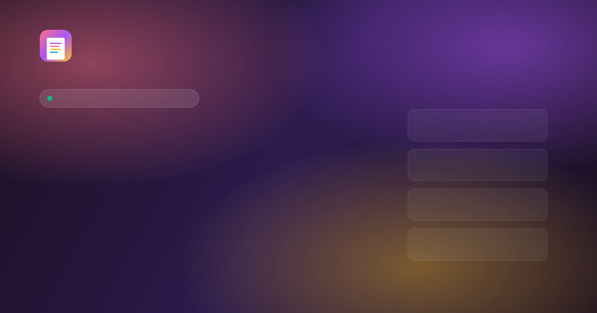

# PDFCraft Studio

> **The world's free PDF workspace — better than iLovePDF.**
>
> 14 real PDF tools. No daily limits. No signup. No watermark. Browser-based, private by design.



## ✨ Features

### PDF Tools (14, all real & working)

**Organize**
- 🔀 Merge PDF — Combine multiple PDFs into one
- ✂️ Split PDF — Extract page ranges or split into individual files
- 🔄 Rotate PDF — Rotate individual pages or all at once
- 📋 Organize Pages — Delete, reorder, rotate pages visually

**Convert**
- 🖼️ PDF to JPG — Convert each page to a JPG image
- 🖼️ JPG to PDF — Combine multiple images into a single PDF
- 📝 PDF to Text — Extract editable text from PDF
- 🖼️ Extract Images — Pull out all embedded images as PNG

**Edit**
- 🔢 Add Page Numbers — Position, format, starting number
- 📌 Add Watermark — Text, color, opacity, rotation, tile/center

**Optimize**
- 🗜️ Compress PDF — 3 compression levels with size comparison
- 📊 PDF Properties — View and edit metadata (title, author, etc.)

**Security**
- 🔓 Unlock PDF — Remove password (when known)
- 🔒 Protect PDF — Honest about browser-based encryption limits

### Visual PDF Editor
- **Edit existing PDF text** — Click any text and edit inline
- Add text, shapes, signatures, images, highlights, freehand drawing
- 3D immersive book-style viewer with page-flip animation
- Undo, redo, zoom, page navigation
- Bold/Italic/Underline text controls

## 🆚 Why PDFCraft Studio?

| Feature | iLovePDF | Sejda | Smallpdf | Canva | Adobe Acrobat | **PDFCraft** |
|---|---|---|---|---|---|---|
| Daily task limit | 2–5/day | 3/hour | 2/day | Unlimited* | View-only | **Unlimited** |
| Sign-up required | After limit | No | Yes | Yes | Yes | **Never** |
| Watermark on free | Some tools | No | Yes | No | Trial only | **No, ever** |
| File upload to servers | Yes | Yes | Yes | Yes | Yes | **No — browser only** |
| Edit existing PDF text | Paid | Limited | Paid | Yes | Paid | **Free** |
| Premium plan price | $7/mo | $5+/wk | $7/mo | $15/mo | $13–20/mo | **No premium** |

## 🛠️ Tech Stack

- **Framework**: Next.js 16 with App Router
- **Language**: TypeScript 5
- **Styling**: Tailwind CSS 4 with shadcn/ui
- **PDF processing**: pdf-lib (manipulation) + pdfjs-dist (rendering)
- **State**: Zustand
- **Animations**: Framer Motion
- **Icons**: Lucide React

## 🚀 Quick Start

```bash
# Install dependencies
bun install

# Run dev server
bun run dev

# Open http://localhost:3000
```

## 🌐 Browser-First Architecture

Everything runs in the browser. No PDFs are ever uploaded to a server.

- `pdf-lib` for PDF manipulation (merge, split, compress, watermark, etc.)
- `pdfjs-dist` for PDF rendering (thumbnails, PDF to JPG, text extraction)
- Web Workers for non-blocking rendering
- Memory-efficient document caching

## 📁 Project Structure

```
src/
├── app/
│   ├── layout.tsx          # SEO/AEO/GEO metadata, JSON-LD structured data
│   ├── page.tsx            # Dynamically loads EditorApp (client-only)
│   └── globals.css        # Premium gradient color system
├── lib/
│   ├── tools-registry.ts   # All 14 tools metadata + categories + search
│   ├── pdf-types.ts        # TypeScript types for annotations
│   ├── pdf-store.ts        # Zustand store
│   └── pdf-utils.ts        # PDF load/render/export utilities
├── components/
│   └── pdf/
│       ├── EditorApp.tsx       # State-based router (hash routing)
│       ├── ToolHub.tsx         # Homepage (tool hub + comparison + FAQ)
│       ├── Toolbar.tsx         # PDF editor toolbar
│       ├── CanvasEditor.tsx    # Main editing canvas
│       ├── Immersive3DView.tsx # 3D book view
│       ├── PageThumbnails.tsx  # Sidebar thumbnails
│       ├── SignaturePad.tsx    # Signature drawing pad
│       └── tools/
│           ├── ToolLayout.tsx          # Shared tool wrapper
│           ├── FileDropZone.tsx        # Reusable upload component
│           ├── MergePdfTool.tsx
│           ├── SplitPdfTool.tsx
│           ├── CompressPdfTool.tsx
│           ├── RotatePdfTool.tsx
│           ├── OrganizePagesTool.tsx
│           ├── PageNumbersTool.tsx
│           ├── WatermarkPdfTool.tsx
│           ├── PdfToJpgTool.tsx
│           ├── JpgToPdfTool.tsx
│           ├── PdfToTextTool.tsx
│           ├── ExtractImagesTool.tsx
│           ├── PdfMetadataTool.tsx
│           ├── UnlockPdfTool.tsx
│           └── ProtectPdfTool.tsx
```

## 📝 SEO/AEO/GEO Features

- Comprehensive metadata (title, description, 30+ keywords)
- JSON-LD structured data (WebApplication, Organization, FAQPage, HowTo, BreadcrumbList)
- Open Graph + Twitter Card meta
- `robots.txt` allowing AI bots (GPTBot, ChatGPT-User, PerplexityBot, ClaudeBot)
- `sitemap.xml` with hreflang alternates
- PWA manifest
- Proper H1 → H2 → H3 heading hierarchy
- Mobile-optimized viewport

## 💰 Business Model

100% free. Forever. Funded by Google AdSense (when approved).

- No premium plans
- No paywalls
- No daily task quotas
- No forced watermarks
- No mandatory signup for core tools

## 📄 License

MIT — free to use, modify and distribute.

## ⚠️ Honest Limitations

- **Protect PDF**: Browser-based PDF encryption is technically limited. The tool explains honestly and recommends desktop alternatives.
- **PDF to Text**: Doesn't work on scanned PDFs (no OCR yet — planned via Tesseract.js).
- **Image element editing in visual editor**: pdf.js operator list uses device-space coordinates that don't directly map to PDF points; users can still cover images with white rectangles or add new images on top.

---

Made with ❤️ for everyone, everywhere.
